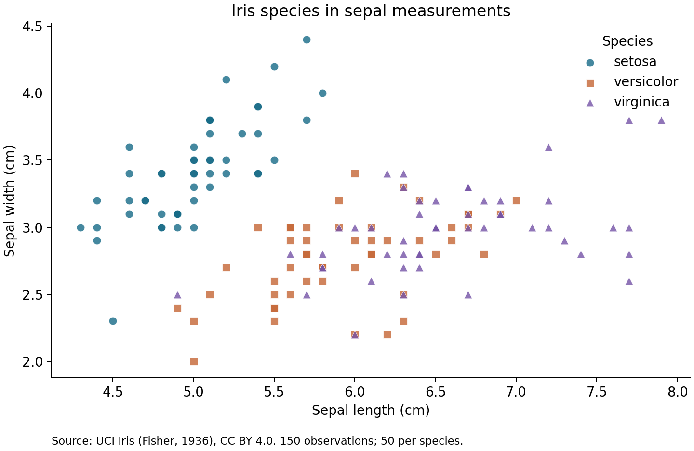

# WEI ZIMING
## Data Science Portfolio

I am a CISC7204 student exploring how data analysis and clear visual communication can answer focused research questions. This portfolio documents an introductory, reproducible analysis and the steps I plan to improve next.

### Technical skills demonstrated in this project
Python · pandas · Matplotlib · exploratory data analysis · scikit-learn pipelines · stratified cross-validation · GitHub documentation

---

## Featured project: Reading Iris measurements

**Research question:** Do petal length and width distinguish Iris species more clearly than sepal length and width?

**Status:** Ongoing — the analysis and improvements responding to the supplied review are complete; see the review log for the feedback and remaining limitation.

### Results at a glance

| Measurements used | Mean accuracy across five folds |
|---|---:|
| Petal length and width | 95.3% |
| Sepal length and width | 81.3% |
| Petal advantage | **14.0 percentage points** |

Accuracy means the proportion of flowers assigned the correct species.

**How the evaluation works:**

1. Divide the 150 flowers into five groups, preserving the species balance.
2. Train a model on four groups and test it on the remaining group. Fit the scaling only on the training groups to prevent leakage.
3. Repeat until each group has been tested once, then average the five test accuracies.
4. Use exactly the same groups for both feature sets to keep the comparison fair.

Each test group contains 30 flowers. The averages describe this dataset and do not guarantee accuracy on newly collected flowers.

The project analyzes 150 flowers across three species. Two scatter plots compare feature pairs, followed by a logistic regression comparison using identical stratified cross-validation splits. Scaling takes place inside each training fold.

**Main visual finding:** Setosa forms a clearly separated group in petal measurements, while versicolor and virginica overlap. Petal measurements show clearer species separation than the sepal measurements below.

**Calculated comparison:** Five-fold mean classification accuracy was **95.3% using petals**, compared with **81.3% using sepals**. Both models used identical folds and training-only scaling. These are within-dataset results, not a guarantee for new samples.

**Interpretation:** The sepal plot shows why a visually plausible feature may still be less useful for distinguishing classes. The project README includes the calculated cross-validation comparison and exact reproduction instructions.

**Limitation:** This small, historical and balanced teaching dataset does not establish performance on flowers collected in a new environment. Visual separation and cross-validation accuracy do not prove causation or universal generalization.

[Explore the project code, results and README →](https://github.com/WEIZIMING369/data-science-project)

### Data and reproducibility
Data: [UCI Iris](https://archive.ics.uci.edu/dataset/53/iris), Fisher (1936), [DOI 10.24432/C56C76](https://doi.org/10.24432/C56C76), licensed under [CC BY 4.0](https://creativecommons.org/licenses/by/4.0/). Measurements are in centimetres. The project includes the original source file, pinned Python dependencies and a runnable analysis script.

### Review and next improvements

The supplied review recommended a more visible comparison and a plain-language explanation of validation. I added an explicit accuracy-gap row and numbered evaluation steps. [Read the supplied feedback and improvement record](review-log.md).

### Next improvements
Future analysis could inspect misclassified flowers, compare additional splits, and evaluate an independent dataset. The review log records the supplied feedback verbatim, including its statement about the missing real classmate review.

---

Prepared for CISC7204 Practice 09 with assistance from OpenAI Codex. Public content contains no student ID or private contact information.

